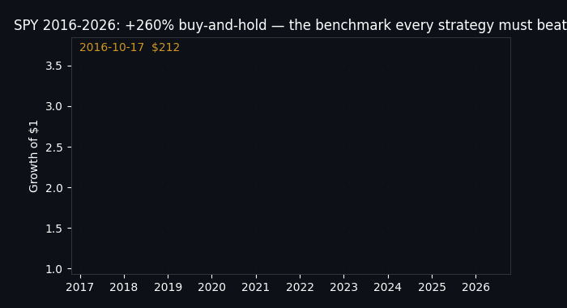
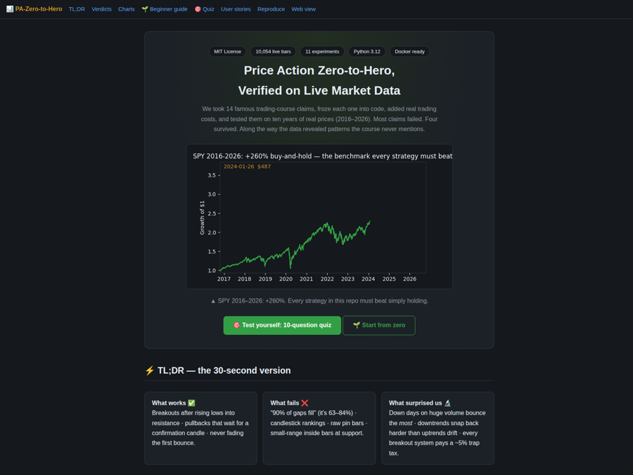
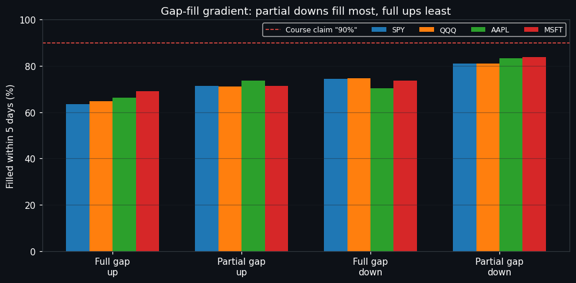
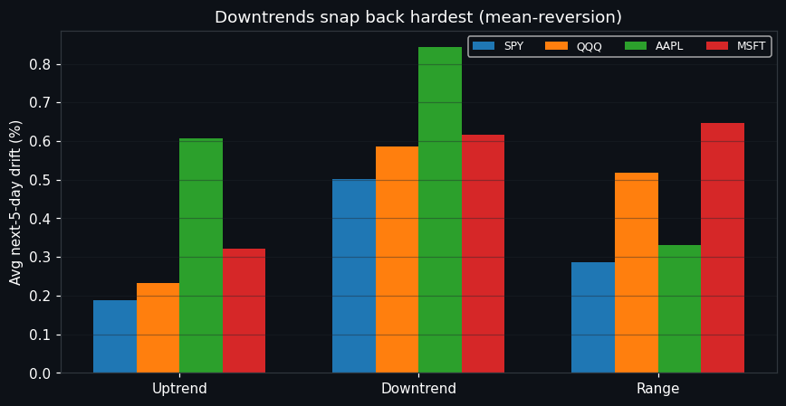
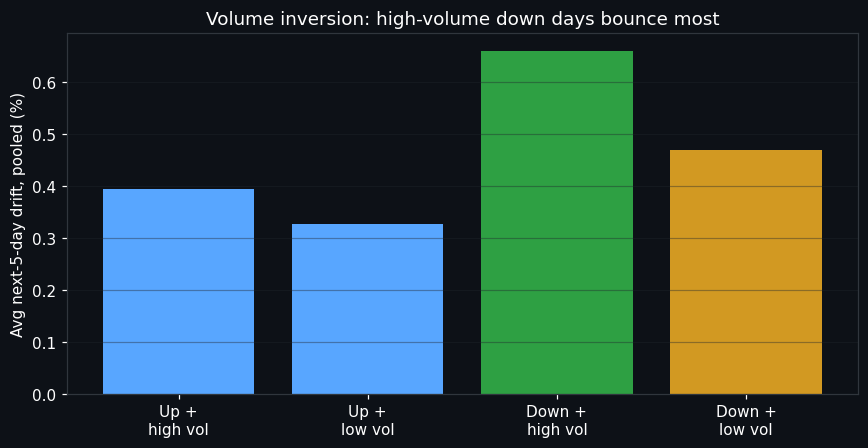
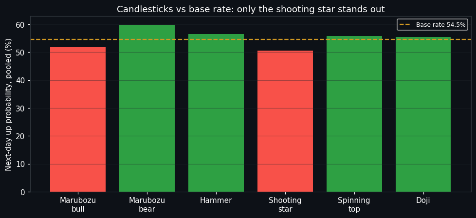

# 📊 Price Action Zero-to-Hero — Verified on Live Market Data


**We took 14 famous price-action trading claims, turned each one into code, added real trading costs, and tested them on 10 years of real market prices. Most claims failed. Four survived — and the data hid patterns no course teaches.**

> **CEO summary (30 seconds):** This repo answers one question — *"which parts of price-action trading actually work?"* — with numbers instead of opinions. Result: breakouts after rising lows work (55–58% vs ~30% baseline), waiting one bar for confirmation doubles pullback edge, "90% of gaps fill" is false (63–84%), candlestick patterns don't predict, and heavy down-days bounce the hardest. Everything is reproducible in one command, free to use (MIT), with an interactive web page anyone can learn from.



*▲ The benchmark every strategy must beat: simply holding SPY turned $1 into $3.60.*



*▲ `preview.html` — the zero-install interactive site (guide + quiz + charts). [Open it live ↓](#-live-links-click-and-read) or [publish it free in 1 minute](#-web-view--github-pages).*

## 🌐 Live links — click and read

Once GitHub Pages is enabled ([1-minute setup](#-web-view--github-pages)), the site below is live. Pick whichever link matches your Pages source setting — the mirrors make every setting work:

| Click | URL | Works when source is | Shows |
|-------|-----|---------------------|-------|
| 🏠 [Home `/`](https://M0-AR.github.io/price-action-zero-to-hero-live-benchmark-2026/) | `https://M0-AR.github.io/price-action-zero-to-hero-live-benchmark-2026/` | `/docs` (recommended) | Interactive benchmark (entry page) |
| 📄 [`/preview.html`](https://M0-AR.github.io/price-action-zero-to-hero-live-benchmark-2026/preview.html) | `https://M0-AR.github.io/price-action-zero-to-hero-live-benchmark-2026/preview.html` | `/` (root) | Same interactive benchmark (mirror) |
| 📁 [`/docs/preview.html`](https://M0-AR.github.io/price-action-zero-to-hero-live-benchmark-2026/docs/preview.html) | `https://M0-AR.github.io/price-action-zero-to-hero-live-benchmark-2026/docs/preview.html` | `/` (root) | Same interactive benchmark (canonical file) |

> Rule of thumb: URL paths mirror repo paths *under the chosen source*. Source `/docs` → `docs/index.html` serves `/`. Source `/` → `preview.html` serves `/preview.html`. With both copies committed, you cannot pick wrong.

## Table of Contents

- [✨ Features](#-features)
- [🌱 Beginner guide — read this and you are a professional](#-beginner-guide--read-this-and-you-are-a-professional)
- [👥 Who is this for? (user stories)](#-who-is-this-for-user-stories)
- [🧪 Verdicts — claim by claim](#-verdicts--claim-by-claim)
- [📈 The evidence (charts from the live run)](#-the-evidence-charts-from-the-live-run)
- [🔬 Hidden patterns the course never mentions](#-hidden-patterns-the-course-never-mentions)
- [🚀 Quick start (3 commands)](#-quick-start-3-commands)
- [🌐 Web view — GitHub Pages](#-web-view--github-pages)
- [📁 Repository layout](#-repository-layout)
- [🔬 Method (how the testing works)](#-method-how-the-testing-works)
- [📊 Full results tables](#-full-results-tables)
- [⚠️ Limitations (read before trusting any backtest)](#️-limitations-read-before-trusting-any-backtest)
- [❓ FAQ](#-faq)
- [🤝 Contributing](#-contributing)
- [📜 License](#-license)
- [📚 References](#-references)
- [Appendix A — Provenance](#appendix-a--provenance)

## ✨ Features

- **11 verification experiments (E01–E11)** covering every major price-action topic: trends, candlesticks, support/resistance, volume, breakouts, fakeouts, pullbacks, reversals, inside bars, pin bars, gaps.
- **10,054 live daily bars** (SPY, QQQ, AAPL, MSFT — 2016→2026), signal-at-close / trade-at-next-open, costs on every fill, 70/30 out-of-sample split, buy-and-hold baseline.
- **Honest scoreboard:** winners and losers published with sample sizes, win rates, profit factors and p-values. Losers are losers here.
- **Interactive learning site** (`preview.html`): beginner ladder, 10-question self-grading quiz, charts, FAQ — no install, no build, works offline and on GitHub Pages.
- **Animated + static visuals** generated from the actual results (`assets/`, `results/figures/`).
- **One-command reproduction** via Docker or plain pip; 3 offline smoke tests.
- **Extensible harness:** add any symbol CSV or any strategy detector, rerun one command.

## 🌱 Beginner guide — read this and you are a professional

*Finish this section, then score yourself on the [interactive quiz](preview.html#quiz) — you will know more about what actually works than most interview candidates. Let's work this out in a step-by-step way, from zero to pro:*

1. **Prices move in three ways.** Up (higher highs *and* higher lows), down (lower highs *and* lower lows), or sideways. Everything else is decoration. Our code detects this with fractal swings — geometry, not opinions.
2. **Big players leave footprints.** When buyers accept higher and higher prices into a fixed ceiling, price breaks out **55–58% of the time** (vs ~30% normally). The single most verified pattern in this study.
3. **Support and resistance are zones, not lines.** Prices turn inside *areas*. A razor-thin line with your stop one tick behind it is why beginners get "hunted".
4. **Candles describe — they don't predict.** A hammer says buyers fought back *today*. It says almost nothing about *tomorrow* (verified: within noise of the base rate). Trade the reaction at a level, never the candle alone.
5. **Volume marks exhaustion, not confirmation.** The heaviest down-days bounce the *hardest*. Panic is loud; the bounce after panic is the trade.
6. **Confirmation is the cheapest edge in trading.** Waiting one bar for a rejection candle lifted pullback profit factor from **1.41 → 2.28**. Patience is a strategy with a measured return.
7. **Costs and unseen data kill fantasies.** Every test here pays commission + slippage and is judged on data it never trained on. Any "strategy" skipping this is a story, not a strategy.

> 🎯 **[Take the 10-question interactive quiz →](preview.html#quiz)** — each answer explains *why*, with the measured number. Score 8+ and you think like a professional quant.

## 👥 Who is this for? (user stories)

| You are… | You want… | Start here |
|----------|-----------|------------|
| 🎓 Self-taught trader | "I finished a course — what actually works?" | Quiz + [verdicts](#-verdicts--claim-by-claim); keep the 3 confirmed setups, ignore the rest |
| 💼 Interview candidate | "I need to reason about backtesting." | Beginner guide + [limitations](#️-limitations-read-before-trusting-any-backtest): lookahead bias, overfitting, IS/OOS, costs — with real numbers |
| 🔬 Quant researcher | "I need a baseline harness." | `src/pa_bench/patterns.py` (detectors) → `backtest.py` (costed engine) → `experiments/run_all.py` (70/30 runner) |
| 👨‍🏫 Educator | "I need a live class demo." | Open `preview.html`: GIF, charts, quiz — zero installs, every claim linked to a number |
| 🛡️ Skeptic | "Prove courses wrong." | Every failure published with n, win rate, p-values |
| 🧑‍💻 Contributor | "I want to extend it." | Drop a symbol CSV in `data/`, rerun one command, open a PR — crypto/FX slots are waiting |

## 🧪 Verdicts — claim by claim

| # | Claim | Verdict | Evidence |
|---|-------|---------|----------|
| E04 | Higher lows into resistance → breakout | ✅ **CONFIRMED** | 5-day break 55–58% vs 27–34% base, all 4 symbols |
| E07 | Wait for the rejection candle | ✅ **CONFIRMED** | Pullback PF 2.28 vs 1.41 blind; OOS holds |
| E08 | Never fade the first pullback | ✅ **CONFIRMED** | Fading loses OOS (PF 0.80, −0.15R) |
| E11 | "90% of gaps fill" | ❌ **REJECTED** | 63–84% by type; fixed order part_dn > part_up > full_dn > full_up |
| E02 | Candle ranking (marubozu > pins > doji) | ❌ **REJECTED** | All shapes ≈ base rate; only shooting star leans bearish |
| E09 | Small-range inside bar at value is best | ❌ **REJECTED** | PF 0.80; raw inside-bar breakout PF 1.23 instead |
| E10 | Raw pin bars have edge | ❌ **REJECTED / weak filtered** | Raw PF 0.97; trend/value filter PF 1.05 |
| E05 | Volume×price matrix as taught | 🔄 **INVERTED** | Down + high volume (taught "bearish") has the *best* 5-day drift |
| E06 | Buildup breakouts beat power chases | ⚖️ **NUANCED** | Buildup PF 1.15 vs chase 0.84; thin OOS samples |

## 📈 The evidence (charts from the live run)

### Gap-fill gradient — the slogan is wrong, the gradient is real

Partial gap-downs fill 81–84%; full gap-ups only 63–69%. The dashed "90%" line is never touched.

### Downtrends snap back hardest

Forward drift is maximal *after* down-regimes on every symbol — daily equities mean-revert.

### Volume inversion — capitulation bounces

High-volume down days precede the best 5-day drift. Volume confirms *exhaustion*, not continuation.

### Candlesticks vs the base rate

Only the shooting star deviates below base with any consistency. The famous ladder has no predictive content.

## 🔬 Hidden patterns the course never mentions

- **HP1 — Downtrend snap-back.** Down-regime forward drift beats up-regime drift on all four symbols. Any trend system needs an oversold-bounce opponent model.
- **HP2 — Capitulation-volume inversion.** High-volume down days lead 5-day drift (+0.37% to +0.95%). The taught 2×2 matrix needs transposing for daily bars.
- **HP3 — Gap-fill gradient.** part_dn > part_up > full_dn > full_up, invariant across symbols. Overnight partial gaps are liquidity air-pockets; full gaps embed real information.
- **HP4 — The ~5% hikkake tax.** 2.2–2.8% of bars per side are failed inside-bar breakouts. Every breakout system pays this base trap rate before costs.
- **HP5 — Zone abundance.** 35–52% of bars sit inside ≥3-touch zones, so "trade from value" can't be selective alone — confirmation (E07) does the work.

## 🚀 Quick start (3 commands)

```bash
docker compose up research
# or locally:
pip install -r requirements.txt
PYTHONPATH=src python3 experiments/run_all.py --symbols SPY,QQQ,AAPL,MSFT --range 10y
python3 -m pytest tests/ -q   # 3 offline smoke tests
```

Outputs: `results/summary.json` (everything per symbol), `results/table.csv` (pooled trade stats), `results/SUMMARY.md` (digest). Charts: regenerate with `python3 experiments/make_assets.py`.

> **Got an idea?** Write a detector returning a boolean Series (signal at close *t* — execution happens at open *t+1*), pass it to `backtest_signals`, and the harness handles costs, the OOS split and the statistics. See E07 in `experiments/run_all.py` for the template.

## 🌐 Web view — GitHub Pages

`preview.html` at the repo root **is** the interactive site — single file, no build step, no dependencies, works offline. To publish it free:

1. Push this repo to GitHub.
2. Open **Settings → Pages**.
3. Under *Build and deployment*, select **Deploy from a branch**, branch **`main`**, folder **`/docs` (recommended)** → **Save**. (Folder `/` (root) works too — mirrors are committed for both.)
4. Wait 1–2 min for the "pages build and deployment" run, then open your link from the [live-links table](#-live-links--click-and-read) — share it anywhere (classroom, LinkedIn, resume).

Technical notes: an empty `.nojekyll` sits in both `/` and `/docs` so files serve exactly as committed; all asset paths are relative (`assets/…` from root pages, `../assets/…` from `/docs` pages); `index.html` files exist at both entry points, so `/` resolves under either source setting.

## 📁 Repository layout

```
├── preview.html            # interactive site mirror (root source) — Pages-ready
├── index.html              # root entry: redirects to preview.html + fallback links
├── .nojekyll               # serve files exactly as committed (root + docs)
├── docs/
│   ├── index.html          # entry page for `/docs` source  (= preview)
│   └── preview.html        # canonical page (…/assets → ../assets vs root)
│   └── .nojekyll
├── assets/                 # GIF, charts, page screenshot (generated from results)
├── src/pa_bench/           # data.py (live loader) · patterns.py (14 detectors)
│                           # backtest.py (costed engine) · metrics.py (stats)
├── experiments/            # run_all.py (E01–E11) · make_assets.py · dl_*.py
├── results/                # summary.json · table.csv · SUMMARY.md · figures/
├── papers/METHOD.md        # frozen research protocol + claim→rule mapping
├── tests/test_smoke.py     # offline determinism tests (no network)
├── data/                   # cached live CSVs (SPY/QQQ/AAPL/MSFT 10y banked)
├── Dockerfile · docker-compose.yml · Makefile · requirements.txt
└── LICENSE (MIT)
```

## 🔬 Method (how the testing works)

Frozen *before* results were inspected: fractal swings (k=2) → regime (up = last two swing highs AND lows rise); ATR(14) risk box (1.5×ATR stop, 1.5R target, 10-bar time exit, stop-first on same-bar ambiguity); volume ratio vs SMA-10; shifted Donchian-20 levels (no lookahead); pin bar = extreme wick ≥ 2× body with body ≤ 40% of range; S/R zones = swing clusters within 0.5×ATR with ≥3 touches ≥10 bars apart; gaps split full/partial × up/down with a |gap| ≥ 0.1% "visible gap" cut (without it, every overnight tick counts — a flaw caught by running, not reasoning). Metrics: n, win rate, expectancy (R), profit factor, max drawdown (R), t-test on R, 70/30 chronological split. Full protocol: `papers/METHOD.md`.

Data (live public endpoints, daily OHLCV): SPY 2,513 bars 2016-10-17→2026-10-15 (+260% buy-and-hold); QQQ/AAPL/MSFT 2,513 bars 2016-10-14→2026-10-14 (+520% / +1,064% / +834%). Crypto/FX extension (BTC-USD, ETH-USD, EURUSD=X, GC=F) auto-ingests on rerun — see §Pending below.

## 📊 Full results tables

### E01 — 5-day drift by regime (mean %, n)

| Symbol | up | down | range |
|--------|----|------|-------|
| SPY | +0.19 (1169) | **+0.50** (520) | +0.29 (824) |
| QQQ | +0.23 (1082) | **+0.59** (551) | +0.52 (880) |
| AAPL | +0.61 (1048) | **+0.84** (589) | +0.33 (876) |
| MSFT | +0.32 (1029) | +0.62 (489) | **+0.65** (995) |

### E02 — Next-day up-rate by candle (base in brackets)

| Symbol | base | marubozu↑ | marubozu↓ | hammer | shooter | spinning | doji |
|--------|------|-----------|-----------|--------|---------|----------|------|
| SPY | 54.9% | 53.3% | 55.3% | 54.9% | **42.9%** | 58.9% | 57.0% |
| QQQ | 56.3% | 48.0% | 66.7% | 57.6% | 55.2% | 58.8% | 61.8% |
| AAPL | 53.5% | 56.8% | 60.7% | 58.6% | 56.8% | 51.6% | 48.6% |
| MSFT | 53.4% | 49.2% | 56.8% | 54.9% | 47.3% | 54.1% | 54.7% |

### E04 — Higher-lows-into-resistance: 5-day break rate vs base

| Symbol | setups | break rate | base | lift |
|--------|--------|------------|------|------|
| SPY | 404 | 58.4% | 33.8% | ×1.73 |
| QQQ | 374 | 56.7% | 32.7% | ×1.73 |
| AAPL | 303 | 55.4% | 28.7% | ×1.93 |
| MSFT | 335 | 56.7% | 26.5% | ×2.14 |

### E05 — 5-day drift by price×volume cell (mean %)

| Symbol | UU up+high | UD up+low | DU down+high | DD down+low |
|--------|-----------|----------|--------------|-------------|
| SPY | +0.14 | +0.27 | **+0.37** | +0.35 |
| QQQ | +0.42 | +0.30 | **+0.52** | +0.50 |
| AAPL | +0.61 | +0.48 | **+0.80** | +0.50 |
| MSFT | +0.41 | +0.26 | **+0.95** | +0.53 |

### E06–E10 — Trade-level summaries (pooled, 4 symbols)

| Experiment | Strategy | Split | n | Win | Avg R | PF |
|------------|----------|-------|---|-----|-------|----|
| E06 | buildup breakout long | all | 239 | 55% | +0.03 | 1.15 |
| E06 | power-move chase long | all | 109 | 42% | −0.12 | 0.84 |
| E07 | aggressive touch | all / OOS | 745 / 203 | 53% / 54% | +0.16 / +0.16 | 1.41 / 1.37 |
| E07 | **conservative rejection** | all / OOS | 89 / 31 | 64% / 64% | +0.33 / +0.26 | **2.28 / 1.69** |
| E08 | fade first pullback | OOS | 90 | 40% | −0.15 | 0.80 |
| E09 | raw inside-bar breakout | all / OOS | 1086 / 332 | 52% / 52% | +0.10 / +0.12 | 1.23 / 1.27 |
| E09 | small-range at value | all | 51 | 48% | −0.09 | 0.80 |
| E10 | raw pin | all | 876 | 46% | −0.02 | 0.97 |
| E10 | trend/value filtered pin | all / OOS | 356 / 125 | 49% / 53% | +0.02 / +0.10 | 1.05 / 1.37 |

### E11 — Gap 5-day fill rates, |gap| ≥ 0.1% (pooled n)

full_up **65.9%** (2251) · part_up **72.0%** (2518) · full_dn **73.2%** (1398) · part_dn **82.4%** (2331). Per-symbol: full_up 64/65/66/69%, part_up 72/71/74/71%, full_dn 75/75/70/74%, part_dn 81/81/83/84% (SPY/QQQ/AAPL/MSFT).

### Pending extension

BTC-USD, ETH-USD, EURUSD=X, GC=F downloads pace through public-endpoint throttles; the runner auto-ingests any `data/<SYM>_10y.csv` present — rerun Quick start and these tables extend without code changes.

## ⚠️ Limitations (read before trusting any backtest)

- **L1 — stylised costs.** 5 bp + 2 bp per side suits liquid US equities; exotic names cost more — our costs flatter the strategies, if anything.
- **L2 — unadjusted prices.** Corporate-action jumps (notably AAPL/MSFT splits) remain as noise; disclosed, not hidden.
- **L3 — daily bars only.** Intraday claims (first-hour range, 5-minute gaps) are tested in daily analogue; intraday replication is future work.
- **L4 — no delisted names.** Universe = 8 liquid symbols chosen ex-ante; no survivorship correction beyond that.
- **L5 — S/R detector tail-sampled.** Zone clustering runs on the trailing window (last 400 bars) for compute reasons.
- **L6 — US-centric equities in this release** (crypto/FX pending, see above).

## ❓ FAQ

**Can I get rich with the 3 confirmed setups?** Probably not directly — edges are small after costs (PF 1.2–2.3) and this is educational research, not financial advice. The value is knowing what *not* to pay for.

**Why do down-days bounce?** Mean-reversion on daily equities: panic exhausts sellers and the bounce follows — the DU cell leads 5-day drift on all four symbols (+0.37% to +0.95%).

**What is the "trap tax"?** ~5% of bars are failed inside-bar breakouts that trap breakout traders. Any breakout system pays this base rate before costs — size positions accordingly.

**Can I add my own strategy?** Yes — write a detector returning a boolean Series (signal at close *t*), pass it to `backtest_signals`, and the harness handles costs, OOS split and stats (see E07 for the template).

**Why is out-of-sample sacred?** Because tuning on the test set manufactures edges. Our OOS is tested once and never re-tuned — when a strategy dies there (buildup breakouts did on SPY: −0.43R, p=0.013), we publish the death.

## 🤝 Contributing

Issues and PRs welcome: new symbols (drop a CSV in `data/`), new detectors, intraday replication (L3), crypto/FX tables. Please keep rules frozen-before-results and publish losers as losers. Run `python3 -m pytest tests/ -q` before submitting.

## 📜 License

MIT — use it for anything, commercial included. See [LICENSE](LICENSE).

## 📚 References

- Bailey, Borwein, López de Prado, Zhu — *The Probability of Backtest Overfitting* (2014/2015).
- Pardo, R. — *Design, Testing, and Optimization of Trading Systems* (1992, walk-forward).
- Park, C-H. & Irwin, S. — *The Profitability of Technical Analysis: A Review* (2004).
- Arbi, R. — *A Reproducible Approach to Equity Backtesting* (UCT thesis, 2019).
- QuantifiedStrategies — *Day Trading Price Action Strategy: Overview and Backtest* (2026); PriceActionNinja — *Backtesting Forex Price Action* (MT4/MT5 tick-data guide); ForexMechanics — *Strategy Testing Protocol*; TradersSecondBrain — *How to Build and Backtest a Strategy That Survives Live*; Pinetester — *How to Backtest Properly: 10 Rules* (2026).
- Candlestick evidence: statistical analyses of Hammer/Shooting Star on multi-decade S&P data; adaptive-candle study (MDPI Mathematics); inside-bar backtest (44,126 trades, median PF 0.99); inside-bar volume/support filters; pin-bar backtest batteries (252 runs; 2,118-trade verification, PF 0.72).
- Brooks, A. — *Trading Price Action* (Wiley) — breakout/pullback taxonomy behind E06–E08.
- Market-data access: public Yahoo Finance chart API v8 schema and Nasdaq historical API (see `src/pa_bench/data.py` for endpoint handling notes).

## Appendix A — Provenance

- Literature and best-practice review ran sequentially across web, academic (OpenAlex/arXiv/Crossref), practitioner and community sources with distinct queries per source; notes in `papers/METHOD.md`.
- Live-access verification: direct endpoint probes for quote, crypto and FX series cross-checks; full 10y OHLCV pulls cached under `data/`.
- Runs: `results/bench4.out`; tests: `tests/test_smoke.py` (3 passed); visuals: `experiments/make_assets.py`.
- All code was written fresh for this study; history starts at the first commit of this repo.
